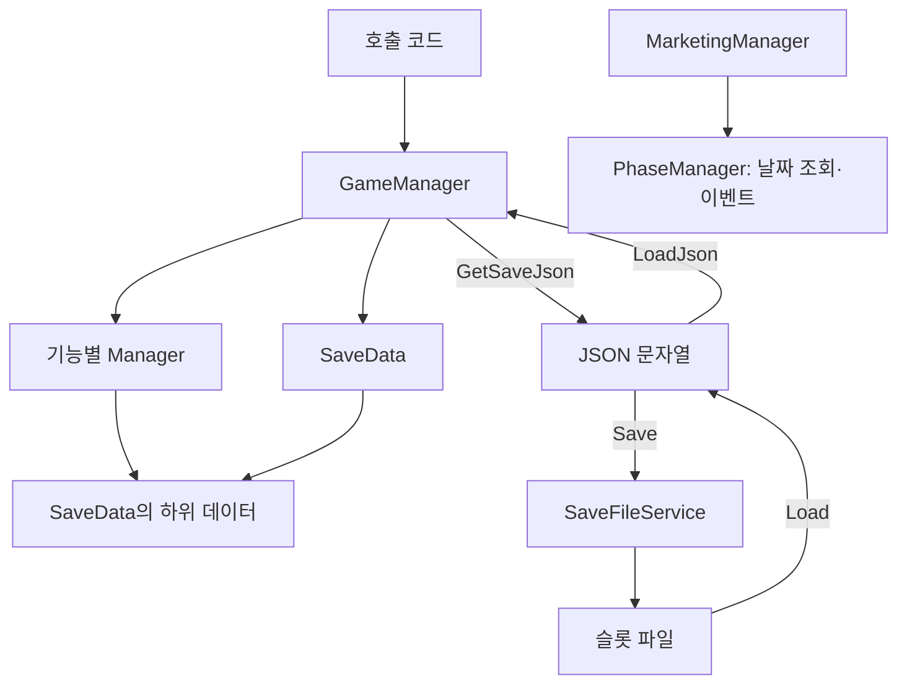

# 공통 시스템 설명서

## 1. 목적과 적용 범위

공통 게임 상태를 조회·변경하고, JSON 및 슬롯 파일로 저장·불러오기 위한 코드의 구조와 사용법을 설명한다.

- 대상 코드: Unity 프로젝트의 `Assets/Scripts`.
- Unity 프로젝트 루트: 저장소의 `Game` 폴더.
- 현재 Editor 버전: `6000.3.25f1`.
- 시작 화면은 연결 예정 지점과 현재 동작만 설명한다.
- 테스트 실행 방법과 상세 검증 목록은 별도 테스트 안내서에서 다룬다.

## 2. 전체 구조와 책임

```text
Assets/Scripts/
├─ Core/
│  ├─ GameManager.cs
│  └─ SaveFileService.cs
├─ Data/
│  └─ SaveData.cs
├─ Enums/
│  ├─ CharacterId.cs
│  ├─ GamePhase.cs
│  ├─ RiceCakeType.cs
│  └─ Route.cs
└─ Managers/
   ├─ PhaseManager.cs
   ├─ EconomyManager.cs
   ├─ ManagementManager.cs
   ├─ ResearchManager.cs
   ├─ MarketingManager.cs
   ├─ AffectionManager.cs
   └─ StoryManager.cs
```

| 구성 | 책임 |
| --- | --- |
| [GameManager](Core/GameManager.cs) | 공통 상태 보관, Manager 초기화, JSON 변환, 불러온 데이터 검증·적용 |
| [SaveData](Data/SaveData.cs) | 저장할 상태를 묶는 직렬화 가능한 데이터 |
| 각 Manager | 전달받은 하위 데이터를 조회·변경하고 해당 기능의 규칙 적용 |
| [SaveFileService](Core/SaveFileService.cs) | 슬롯별 JSON 파일 쓰기·읽기·존재 여부 조회 |
| [Enums](Enums) | 캐릭터, 시간대, 떡 종류, 루트의 식별자 정의 |



`GameManager`만 `MonoBehaviour`다. 각 Manager와 `SaveFileService`는 일반 C# 클래스이므로 별도의 GameObject에 붙이지 않는다. `SaveFileService`는 `GameManager`가 자동 생성하지 않으며, 파일 처리가 필요한 호출 코드에서 생성한다.

## 3. 데이터 구조

### 3.1. SaveData

| 필드 | 초기값 / 역할 |
| --- | --- |
| `saveVersion` | `1`. 저장 형식 식별용이며 현재 버전 검사·변환은 수행하지 않음 |
| `savedAt` | `null`. 저장 시각을 담을 자리이며 현재 자동으로 기록하지 않음 |
| `playTime` | `0`. `GameManager.Update`가 `Time.deltaTime`으로 누적하는 초 단위 시간 |
| `phase` | 날짜·시간대 |
| `economy` | 자금 |
| `management` | 평판·떡 재고 |
| `research` | 완료 연구 ID 목록 |
| `marketing` | 캐릭터별 마케팅 상태 |
| `affection` | 캐릭터별 호감도 |
| `story` | 이벤트 기록·루트·대사 위치·선택 이력 |

`playTime`은 `Time.timeScale`의 영향을 받는다. `GameManager`가 비활성화되어 있거나 시간 배율이 0이면 누적되지 않는다.

### 3.2. 하위 데이터

| 타입 | 주요 필드와 초기 상태 |
| --- | --- |
| `PhaseData` | `day = 1`, `phase = GamePhase.Morning` |
| `EconomyData` | `money = 100000` |
| `ManagementData` | `reputation = 0`, 빈 `riceCakeStocks` |
| `RiceCakeStock` | `type`, `preparedQuantity`, `remainingQuantity` |
| `ResearchData` | 빈 `completedResearchIds` |
| `CharacterMarketingData` | `usedThisWeek = false`, `firstUsed = false`, `applyDay = 0` |
| `MarketingData` | 채린·소은·서경의 `CharacterMarketingData` |
| `AffectionData` | 세 캐릭터의 호감도 `0` |
| `StoryData` | 빈 완료 이벤트·선택 이력 목록, 루트·이벤트 ID는 `null`, `lineIndex = -1` |

- `preparedQuantity`는 생산 확정량이다. 판매 시에는 `remainingQuantity`만 감소한다.
- `firstUsed`는 한 번이라도 마케팅을 사용했는지 나타낸다. 주간 초기화 후에도 유지된다.
- `applyDay = 0`은 마케팅 적용일 미지정이다.
- `StoryData.currentRoute`는 문자열이다. 현재 `Route` enum을 직접 저장하거나 변환하지 않는다.
- `lineIndex = -1`은 대사 위치가 지정되지 않은 초기 상태다.

### 3.3. 참조 공유

Manager는 전달받은 데이터 객체를 복사하지 않고 참조한다.

```csharp
EconomyData data = new EconomyData();
EconomyManager economy = new EconomyManager(data);

economy.AddMoney(500);
// data.money도 100500으로 변경된다.
```

데이터 필드는 공개되어 있으므로 직접 값을 바꿀 수도 있지만, 그러면 Manager의 입력 검사나 이벤트 처리를 거치지 않는다. 일반적인 게임 상태 변경은 Manager API를 통해 요청한다.

각 Manager의 `LoadData`는 데이터 참조를 교체한다. 전체 저장 상태를 불러올 때는 `GameManager.LoadState` 또는 `LoadJson`을 사용해 모든 Manager의 참조를 함께 갱신한다.

## 4. 초기화와 상태 교체 흐름

### 4.1. 초기화와 생명주기

1. 공통 기능을 사용할 씬의 루트 GameObject에 `GameManager` 컴포넌트를 붙인다.
2. `Awake`에서 첫 인스턴스를 `GameManager.Instance`로 등록한다.
3. `DontDestroyOnLoad`로 해당 객체를 씬 전환 후에도 유지한다.
4. `new SaveData()`로 기본 상태를 만들고 각 Manager에 하위 데이터를 전달한다.
5. 중복 `GameManager`가 생성되면 중복 객체만 제거하고 기존 진행을 유지한다.

초기화 시 저장 파일을 자동으로 읽지는 않는다. 시작 화면에서 새로 하기를 누르면 `GameManager`가 없을 때 생성하고, `StartNewGame()`으로 공통 상태를 초기화한 뒤 프롤로그로 이동한다.

다른 GameObject의 `Awake`와 실행 순서는 보장되지 않으므로, `Start` 등 `GameManager.Awake`가 끝난 뒤 접근한다. 동적으로 생성하는 경우에는 생성 완료 후 접근한다.

### 4.2. 불러오기 순서

```text
LoadJson(json)
  → JsonUtility.FromJson<SaveData>(json)
  → LoadState(data)
      → null 입력 거부
      → 누락된 하위 객체를 기본값으로 보완
      → 저장값 검증
      → 현재 SaveData 참조 교체
      → 기존 Manager들의 데이터 참조 교체
```

- JSON 변환이나 값 검증에서 실패하면 현재 상태를 교체하지 않는다.
- 기존 Manager 인스턴스를 유지하므로 외부에서 보관한 Manager 참조와 이벤트 구독도 유지된다.
- `PhaseManager.LoadData`는 시간 진행 이벤트를 발생시키지 않는다. 불러오기만으로 마케팅 주간 초기화를 실행하지 않는다.
- `LoadState`는 전달받은 객체 자체를 사용하며, 누락된 하위 객체를 그 입력에 채운다. 입력의 독립적인 복사본을 만들지는 않는다.
- 호출 전에 현재 데이터 객체를 외부에서 직접 수정했다면, 그 변경을 불러오기 검증이 되돌려 주지는 않는다.

### 4.3. 복구·검증 범위

누락된 `phase`, `economy`, `management`, `research`, `marketing`, `affection`, `story` 객체는 각각 기본 데이터로 보완한다.

내부 데이터 중에서는 재고 목록, 연구 완료 목록, 마케팅의 캐릭터별 객체가 `null`이면 각 Manager가 기본값으로 복구한다.

| 대상 | 거부 조건 |
| --- | --- |
| 날짜 | `day < 1` |
| 시간대 | 정의되지 않은 `GamePhase` |
| 자금·평판 | 음수 |
| 플레이 시간 | `playTime < 0` |
| 호감도 | 세 캐릭터 중 하나라도 0~100 범위 밖 |
| 재고 항목 | `null` 항목, 정의되지 않은 떡 종류, 같은 종류 중복 |
| 재고 수량 | 음수, 남은 수량이 생산량보다 많음 |

위 조건은 `ArgumentException` 계열 예외로 거부한다. 전체 입력이 `null`이면 `ArgumentNullException`이 발생한다.

검증은 위 표에 한정된다. 저장된 연구·이벤트 ID의 의미, 마케팅 적용일, 스토리 대사 범위 등 모든 필드를 검증하는 것은 아니다. 스토리 내부 목록의 `null`도 현재 자동 복구 대상에 포함되지 않는다.

## 5. Manager별 사용법과 규칙

다음의 짧은 예시는 `GameManager` 초기화가 끝난 뒤 호출하는 메서드 본문을 기준으로 한다.

### 5.1. PhaseManager

| API | 동작 |
| --- | --- |
| `GetDay()` | 현재 누적 날짜 반환 |
| `AdvancePhase()` | 다음 시간대로 진행 |
| `OnPhaseChanged` | 시간대 변경 후 새 시간대를 전달 |
| `OnDayChanged` | 날짜 변경 후 새 날짜를 전달 |
| `LoadData(PhaseData)` | 이벤트 없이 데이터 참조 교체 |

```text
Morning → Lunch → Closing → Evening → 다음 날 Morning
```

`Evening`에서 진행하면 날짜가 1 증가하고 다음 날 아침으로 넘어간다. 다음 날 전환은 다음 순서다.

1. 날짜 증가.
2. `OnDayChanged` 발생. 이 시점의 시간대는 아직 `Evening`.
3. 시간대를 `Morning`으로 변경.
4. `OnPhaseChanged` 발생.

```csharp
GameManager.Instance.Phase.AdvancePhase();
```

### 5.2. EconomyManager

| API | 동작 |
| --- | --- |
| `GetMoney()` | 현재 자금 반환 |
| `AddMoney(int amount)` | 0 이상 금액 추가 |
| `TrySpendMoney(int amount)` | 지출 성공 시 차감하고 `true`, 음수·잔액 부족이면 변경 없이 `false` |

`AddMoney`의 음수 입력은 `ArgumentOutOfRangeException`, 합산 오버플로는 `OverflowException`으로 거부한다. 이 경우 기존 잔액을 유지한다.

```csharp
bool spent = GameManager.Instance.Economy.TrySpendMoney(1000);
if (!spent)
    UnityEngine.Debug.Log("지출할 수 없습니다.");
```

### 5.3. ManagementManager

| API | 동작 |
| --- | --- |
| `GetReputation()` | 현재 평판 반환 |
| `AddReputation(int amount)` | 0 이상 평판 추가. 음수·합산 오버플로는 예외 |
| `GetPreparedQuantity(RiceCakeType type)` | 생산 확정량 반환. 미등록 종류는 0 |
| `GetRemainingQuantity(RiceCakeType type)` | 남은 재고 반환. 미등록 종류는 0 |
| `SetPreparedQuantity(RiceCakeType type, int quantity)` | 생산량과 남은 재고를 모두 지정 수량으로 설정 |
| `TrySellRiceCake(RiceCakeType type, int quantity)` | 양수이며 재고가 충분할 때 남은 수량만 차감하고 `true` |

정의되지 않은 떡 종류와 음수 생산량은 예외다. 판매 수량이 0 이하이거나 재고가 부족하면 `false`를 반환한다. 생산량을 다시 설정하면 판매 후 남은 재고도 덮어쓴다.

```csharp
ManagementManager management = GameManager.Instance.Management;
management.SetPreparedQuantity(RiceCakeType.Garaetteok, 10);
bool sold = management.TrySellRiceCake(RiceCakeType.Garaetteok, 3);
// sold == true, 생산량 10, 남은 재고 7
```

재고 차감은 자금 추가·지출을 자동으로 수행하지 않는다. 생산비와 판매 수익의 정산은 호출 측에서 조합한다.

### 5.4. ResearchManager

| API | 동작 |
| --- | --- |
| `IsResearchCompleted(string researchId)` | 완료 여부 조회 |
| `CompleteResearch(string researchId)` | 유효한 연구를 완료 기록에 추가. 이미 완료했으면 변경 없음 |

유효 ID는 `RCP-01`, `RCP-02`, `RCP-03`, `RCP-04`, `DSP-01`, `DSP-02`다. 빈 값·미등록 ID는 두 API 모두 `ArgumentException`으로 거부한다. 대소문자나 앞뒤 공백을 자동으로 보정하지 않는다.

```csharp
ResearchManager research = GameManager.Instance.Research;
bool completed = research.IsResearchCompleted("RCP-01");
```

선행 연구, 비용, 행동 가능 여부는 실제 연구를 실행하는 호출 측에서 검증해야 한다. 완료 기록을 추가하는 것만으로 자금 차감이나 효과 적용이 발생하지 않는다.

### 5.5. MarketingManager

| API | 동작 |
| --- | --- |
| `IsMarketingUsedThisWeek(string marketingId)` | 이번 주 사용 여부 |
| `IsMarketingFirstUsed(string marketingId)` | 한 번이라도 사용했는지 여부 |
| `UseMarketing(string marketingId)` | 주간 사용·최초 사용 플래그와 다음 영업일 기록 |
| `IsMarketingActive(string marketingId)` | 적용일이 0보다 크고 현재 날짜와 같은지 반환 |

지원 ID는 `MarketingManager.ChaerinId`(`MKT-CH`)와 `MarketingManager.SoeunId`(`MKT-SE`)다. 미등록 ID는 `ArgumentException`, 같은 주 재사용은 `InvalidOperationException`으로 거부한다.

- 1일차를 월요일로 본다.
- 월~목요일 사용은 다음 날, 금~일요일 사용은 다음 월요일에 적용된다.
- 1·8·15일차처럼 새 주의 첫날로 진행하면 `usedThisWeek`만 초기화한다.
- `firstUsed`와 `applyDay`는 주간 초기화 후에도 유지된다.
- 적용일 계산이 실패하면 사용 상태를 변경하지 않는다.
- 효과 적용 여부를 조회할 수 있지만 실제 효과를 다른 기능에 적용하는 처리는 호출 측의 책임이다.

```csharp
MarketingManager marketing = GameManager.Instance.Marketing;
bool used = marketing.IsMarketingUsedThisWeek(MarketingManager.ChaerinId);
if (!used)
    marketing.UseMarketing(MarketingManager.ChaerinId);
```

### 5.6. AffectionManager

| API | 동작 |
| --- | --- |
| `GetAffection(CharacterId id)` | 해당 캐릭터의 호감도 반환 |
| `AddAffection(CharacterId id, int amount)` | 양수·음수 변화량을 적용하고 0~100으로 제한 |

세 캐릭터의 값은 독립적이다. 정의되지 않은 `CharacterId`는 예외로 거부한다. 덧셈은 `long`으로 수행해 극단적인 `int` 변화량의 오버플로를 방지한다.

```csharp
GameManager.Instance.Affection.AddAffection(CharacterId.Chaerin, 5);
```

### 5.7. StoryManager

현재 제공하는 기능은 `StoryManager(StoryData)`와 `LoadData(StoryData)`다. 전달받은 데이터를 보관·교체하며 `null`은 거부한다.

대사 조회·진행, 선택지 처리, 이벤트 완료, 루트 분기 API는 아직 없다. `StoryData`에 해당 저장 필드가 있다는 사실만으로 진행 기능이 구현된 것은 아니다.

### 5.8. 공통 데이터 교체 규칙

각 Manager의 생성자와 `LoadData`는 `null` 데이터 입력을 `ArgumentNullException`으로 거부한다. Manager별 `LoadData`가 `GameManager.LoadState`의 전체 저장값 검증까지 수행하지는 않는다.

## 6. 파일 저장·불러오기

### 6.1. 저장 위치와 생성 시점

기본 경로는 `Path.Combine(Application.persistentDataPath, "Saves")`다. 절대 경로는 `SaveFileService.DirectoryPath`로 확인할 수 있다.

```text
Application.persistentDataPath/
└─ Saves/
   ├─ slot-1.json
   ├─ slot-2.json
   └─ slot-3.json
```

위 구조는 모든 슬롯에 저장했을 때의 모습이다.

- 생성자·존재 조회·읽기는 저장 폴더나 빈 슬롯 파일을 만들지 않는다.
- 실제 저장 요청이 들어올 때 폴더와 선택한 슬롯 파일을 생성한다.
- 사용하지 않은 슬롯은 파일 없이 유지한다.
- 테스트나 별도 경로가 필요하면 `new SaveFileService(directoryPath)`로 저장 폴더를 전달한다.
- `savedAt`은 현재 파일 저장 시에도 자동 갱신하지 않는다.

### 6.2. API와 저장 방식

| API | 동작 |
| --- | --- |
| `Save(int slot, string json)` | JSON을 해당 슬롯에 기록하거나 기존 내용을 교체 |
| `Load(int slot)` | 파일의 문자열을 읽어서 반환 |
| `Exists(int slot)` | 해당 경로에 파일이 존재하는지 반환 |
| `SlotCount` | 현재 슬롯 수 `3` |

슬롯 번호는 **1~3**이다. 범위 밖 번호는 세 API 모두 `ArgumentOutOfRangeException`으로 거부한다. 저장할 문자열이 `null`·빈 문자열·공백이면 `ArgumentException`이 발생한다.

저장은 다음 순서로 수행한다.

1. 슬롯 번호와 빈 문자열 여부 검사.
2. 저장 폴더 생성.
3. 같은 폴더에 고유한 이름의 `.tmp` 파일 작성.
4. 기존 슬롯이 있으면 `File.Replace`, 없으면 `File.Move`로 최종 경로에 반영.
5. 이번 요청의 임시 파일이 남아 있으면 정리.

교체에 실패했을 때 기존 저장 파일을 삭제하고 다시 쓰는 방식으로 우회하지 않는다. 남은 임시 파일은 정상 슬롯으로 취급하지 않으며, 이전 요청의 임시 파일을 자동 복구하거나 일괄 삭제하지도 않는다.

`SaveFileService`는 문자열의 JSON 형식이나 저장값을 검증하지 않는다. `Exists`가 `true`여도 정상적으로 불러올 수 있다는 보장은 없으며, 내용 검증은 `GameManager.LoadJson`을 호출할 때 수행된다.

### 6.3. 저장과 불러오기 예시

다음 코드는 초기화된 `GameManager`를 사용하는 메서드 본문의 예시다.

```csharp
GameManager game = GameManager.Instance;
SaveFileService files = new SaveFileService();

string json = game.GetSaveJson();
files.Save(1, json);
```

```csharp
GameManager game = GameManager.Instance;
SaveFileService files = new SaveFileService();

string json = files.Load(1);
game.LoadJson(json);
```

`files.Load`는 파일 읽기까지 수행한다. 반환받은 문자열을 `game.LoadJson`에 전달해야 검증과 게임 상태 적용이 일어난다.

### 6.4. 실패 처리 예시

파일 없음·파일 접근 실패·JSON 검증 실패는 호출 측으로 예외가 전달된다. 아래 예시는 성공 여부를 반환해 호출 화면에서 안내 여부를 결정할 수 있도록 한다.

```csharp
using System;
using System.IO;
using UnityEngine;

public static class SaveLoadExample
{
    // GameManager 초기화 이후에 호출한다.
    public static bool TryLoadSlot(GameManager game, int slot)
    {
        if (game == null)
            throw new ArgumentNullException(nameof(game));

        SaveFileService files = new SaveFileService();
        try
        {
            string json = files.Load(slot);
            game.LoadJson(json);
            return true;
        }
        catch (IOException error)
        {
            Debug.LogWarning("저장 파일을 읽을 수 없습니다: " + error.Message);
        }
        catch (UnauthorizedAccessException error)
        {
            Debug.LogWarning("저장 파일 접근 권한이 없습니다: " + error.Message);
        }
        catch (ArgumentException error)
        {
            Debug.LogWarning("슬롯 번호나 저장 데이터가 올바르지 않습니다: " + error.Message);
        }

        return false;
    }
}
```

이 예시는 사용법을 설명하는 코드이며 프로젝트에 해당 클래스가 추가되어 있지는 않다. 저장 호출에서도 파일 접근·입력 오류를 처리해야 한다.

실패 시 기존 게임 상태와 원본 파일은 유지된다. 실패 안내 화면, 재시도, 다른 슬롯 선택은 호출 측에서 구성하며 현재 시작 화면에는 연결하지 않았다.

## 7. 다른 코드에서 사용하는 방법

### 7.1. 접근과 기능 조합

`GameManager.Instance`를 통해 필요한 Manager에 요청한다. 각 Manager를 호출한 것만으로 다른 기능까지 자동 실행되지는 않는다.

| 요청 | 호출 측에서 추가로 처리할 일 |
| --- | --- |
| 재고 생산량 설정 | 생산 가능 여부·생산비·행동 시점 판단 |
| 재고 판매 | 판매 가격·수익 반영 |
| 연구 완료 기록 | 선행 조건·비용·실행 가능 여부 확인 및 효과 적용 |
| 마케팅 사용 | 실제 효과를 적용할 기능에 활성 여부 전달 |
| 호감도 변경 | 어떤 선택이나 이벤트에서 얼마를 변경할지 결정 |

여러 Manager에 걸친 변경을 한 번에 되돌리는 기능은 없다. 여러 상태를 변경하는 행동은 필요한 조건을 먼저 확인하고 적용 순서를 설계한다.

`GameManager.Instance.StartNewGame()`은 공통 상태를 새 게임 기본값으로 되돌린다. 시작 화면에서는 `MainMenuController`가 초기화 후 프롤로그로 이동한다.

### 7.2. 날짜·시간대 이벤트 구독

구독한 `PhaseManager` 참조를 보관하고 해제할 때도 같은 참조를 사용한다. `GameManager.LoadState` 이후에도 이 구독은 유지된다.

```csharp
using UnityEngine;

public class PhaseListenerExample : MonoBehaviour
{
    private PhaseManager phase;

    private void Start()
    {
        GameManager game = GameManager.Instance;
        if (game == null)
        {
            Debug.LogError("GameManager 초기화가 필요합니다.");
            return;
        }

        phase = game.Phase;
        phase.OnDayChanged += HandleDayChanged;
        phase.OnPhaseChanged += HandlePhaseChanged;
    }

    private void OnDestroy()
    {
        if (phase == null)
            return;

        phase.OnDayChanged -= HandleDayChanged;
        phase.OnPhaseChanged -= HandlePhaseChanged;
    }

    private void HandleDayChanged(int day)
    {
        Debug.Log("날짜 변경: " + day);
    }

    private void HandlePhaseChanged(GamePhase currentPhase)
    {
        Debug.Log("시간대 변경: " + currentPhase);
    }
}
```

이 예시도 설명용 클래스다. 비활성화 시 구독을 해제하는 화면을 만들 경우에는 재활성화 시 다시 구독하는 처리도 함께 구성한다.

### 7.3. 시작 화면 연결 지점

시작 화면 씬은 `Assets/Scenes/MainMenu.unity`, 제어 코드는 [MainMenuController](../UI/MainMenu/MainMenuController.cs)다.

| 버튼 | 현재 동작 | 추후 연결 지점 |
| --- | --- | --- |
| 새로 하기 | 공통 상태를 초기화하고 프롤로그로 이동 | — |
| 이어 하기 | Inspector의 임시 저장 표시가 있을 때 활성화, 슬롯 패널 표시 | 실제 슬롯 조회 결과 반영 |
| 슬롯 선택 | 선택 피드백만 표시 | 파일 읽기 → JSON 검증·적용 → 성공 후 게임 화면 전환 |
| 환경 설정 | Master·BGM·SFX 음량과 화면 모드 변경, 기본값 복원, 패널을 닫을 때 설정 저장 | — |
| 종료 | 빌드에서 앱 종료, Editor에서 Play Mode 종료 | 현재 동작 유지 |

현재 UI는 `SaveFileService`와 연결되어 있지 않다. Inspector의 임시 `hasSaveData`가 버튼 상태를 결정한다.

`MainMenuController.SelectSlot(int index)`의 배열 인덱스는 **0~2**, `SaveFileService`의 슬롯 번호는 **1~3**이다. 추후 연결 시 `slot = index + 1`로 대응시킨다.

## 8. 현재 제약과 남은 작업

| 항목 | 현재 상태 |
| --- | --- |
| 이어 하기와 실제 저장 연결 | 임시 슬롯 데이터를 표시하고 선택 피드백만 제공 |
| 자동 저장 | 저장 시점과 자동 호출 정책 미정 |
| 저장 시각 | `savedAt` 필드는 있으나 자동 기록 미구현 |
| 저장 버전 호환 | `saveVersion` 필드는 있으나 버전 검사·변환 정책 미정 |
| 스토리 진행 | 데이터 보관·교체만 구현 |
| 서경 마케팅 | 저장 데이터만 준비, 공개 마케팅 ID·사용 처리 미구현 |
| 파일 실패 안내 | 예외는 전달되지만 사용자용 안내·재시도 화면은 미연결 |

이미 구현된 데이터 조회·변경, 불러오기 검증, 슬롯별 파일 저장·읽기를 기반으로 필요한 실행 흐름과 화면을 연결한다.
